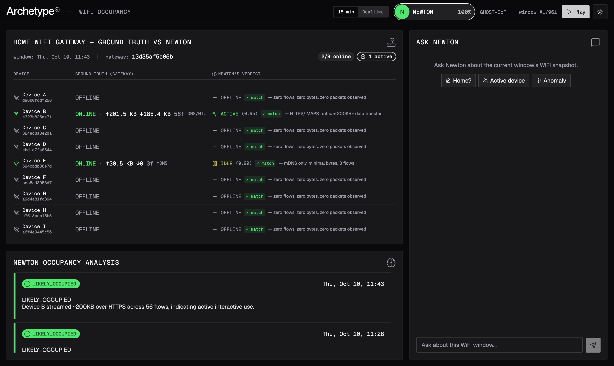

# Newton WiFi Demo (Inference API)

A replay-style demo that asks **"is anyone home?"** from real residential WiFi device-telemetry, powered by [Newton](https://www.archetypeai.io/).

The app walks through a real 10-day smart-home WiFi capture one window at a time. Each window is a JSON snapshot of every device seen by the home gateway — which MACs were online, how much they sent and received, and which protocols they spoke. Newton reads the snapshot and returns both an overall occupancy verdict and a per-device classification, side-by-side with ground truth.

This is the Inference API version of [archetypeai-wifi-demo](https://github.com/archetypeai/archetypeai-wifi-demo), which uses the Direct Query API. [MIGRATION.md](MIGRATION.md) explains what changed and compares the two.



## Two playback modes

- **15-min** — aggregated 15-minute snapshots matching the cadence of a typical residential-gateway `wifi_status_report`. Auto-advance through the 61 windows with any device activity, or scrub the full 962-window session.
- **Realtime** — rolling window whose width tracks the analysis cadence (1 s / 2 s / 5 s / 10 s / 30 s). Newton fires on a wall-clock tick, reasoning over a fresh, non-overlapping slice each call.

## Data attribution

This demo uses the **GHOST-IoT** dataset by Anagnostopoulos, Spathoulas, Viaño, and Augusto-Gonzalez (2020), published in the upstream repository below and described in an open-access MDPI article.

> Anagnostopoulos, M.; Spathoulas, G.; Viaño, B.; Augusto-Gonzalez, J. **Tracing Your Smart-Home Devices Conversations: A Real World IoT Traffic Data-Set.** *Sensors* 2020, 20, 6600. [https://doi.org/10.3390/s20226600](https://doi.org/10.3390/s20226600)

- **Repository:** https://github.com/gspathoulas/ghost-iot-dataset
- **License:** the upstream repository publishes the data without a licence and asks users to cite the paper above
- **Capture:** real smart-home deployment, multiple network interfaces, Oct 10 – 20, 2019
- **This demo uses:** only the WiFi interface (`wlan0_ipv4_flows_db.csv`)

MACs in the dataset are anonymized. We label the 9 WiFi clients as `Device A` … `Device I` in descending order of flow count. Newton reasons purely from traffic patterns — no device-type labels are given to the model.

The GHOST project was funded by the EU Horizon 2020 programme.

## Features

- **Ground Truth vs Newton** comparison card — per-device ground-truth state next to Newton's classification (`ACTIVE` / `IDLE` / `OFFLINE`) with match/mismatch badges
- **Newton Occupancy Analysis** — rolling log of per-window verdicts (`OCCUPIED` / `LIKELY_OCCUPIED` / `AMBIGUOUS` / `LIKELY_EMPTY` / `EMPTY`) with the reason Newton gave
- **Ask Newton** — interactive chat with follow-up questions; each message is tagged with the window it was about so paused conversations don't get confused with later state
- **Skip gaps** — auto-jump the playhead through long quiet stretches
- **Stale-prediction guard** — per-device Newton output is tagged with its source frame; if the displayed frame advances faster than Newton can respond, the Newton column shows a loading skeleton instead of stale text

## Stack

- **SvelteKit** with Svelte 5 runes
- **Archetype AI Design System** — semantic tokens, primitives, patterns
- **Geist and Geist Mono** — open-source fonts from `@fontsource-variable`
- **Newton Inference API** — Newton C 2.6 (`newton-c-2.6`) through the stateless query endpoint (`POST /api/inference/query`); JSON snapshot sent as text in the prompt; three SvelteKit server routes (15-min analyze, realtime analyze, per-device predict) all funnel through the same Newton endpoint with purpose-built system prompts (see [Newton API](#newton-api))
- **Python** preprocessing (one-time) to reshape GHOST-IoT flows into snapshot frames + an event stream

## Setup

### 1. Install JS dependencies

Requires Node.js 20 or later:

```bash
git clone https://github.com/archetypeai/archetypeai-wifi-demo-inference-api.git
cd archetypeai-wifi-demo-inference-api
npm install
```

### 2. (Optional) re-run preprocessing

The processed dataset is committed to the repo, so the demo runs without any preprocessing step. The GHOST-IoT WiFi flow CSV (`wlan0_ipv4_flows_db.csv`) is also included at `data/ghost-iot/` so you can re-run the preprocessor if you edit it:

```bash
python3 scripts/preprocess.py
```

This regenerates:
- `data/processed/session-01/manifest.json` — session metadata, device inventory, per-window activity, highlight list
- `data/processed/session-01/frames/{0000..0961}.json` — one JSON per 15-min window
- `data/processed/session-01/events.jsonl` — flat per-flow event stream (used by Realtime mode)

For the complete GHOST-IoT dataset (Bluetooth, Zigbee, Ethernet, PPP interfaces — not used by this demo), clone the upstream repo:

```bash
git clone https://github.com/gspathoulas/ghost-iot-dataset.git
```

### 3. Configure API credentials

```bash
cp .env.example .env      # then add your API key
```

`.env` holds your Archetype AI API key and the production endpoint:

```
ATAI_API_KEY=your_api_key_here
ATAI_API_ENDPOINT=https://platform.u1.archetypeai.app
```

The `.env` file wins over any `ATAI_*` variables exported in your shell (see `vite.config.js`).

### 4. Run

```bash
npm run dev
```

Open `http://localhost:5173`, then click **Play** to begin.

## Architecture

```
src/
├── routes/
│   ├── +page.svelte                      # Dashboard orchestrator
│   └── api/
│       ├── analyze/+server.js            # 15-min occupancy verdict (Newton C 2.6)
│       ├── analyze-realtime/+server.js   # Rolling-window occupancy verdict
│       ├── predict-devices/+server.js    # Per-device ACTIVE/IDLE/OFFLINE
│       ├── manifest/+server.js           # GET processed session manifest
│       ├── frame/[index]/+server.js      # GET single frame by index
│       └── events/+server.js             # GET full event stream (realtime mode)
├── lib/
│   ├── server/newton.js                  # Server-side Inference API client
│   ├── api/newton.js                     # Client-side fetch wrappers
│   └── components/ui/custom/
│       ├── comparison-grid.svelte        # Ground Truth vs Newton row-by-row
│       ├── analysis-log.svelte           # Rolling occupancy verdict history
│       └── chat-panel.svelte             # Interactive Q&A with Newton

scripts/
└── preprocess.py                         # GHOST-IoT wlan0 flows → frames + events

data/                                     # committed (see Licence)
├── ghost-iot/                            # raw dataset (after clone + unrar)
└── processed/session-01/                 # manifest.json, frames/, events.jsonl
```

## How it works

1. On load, the client fetches `manifest.json`. In realtime mode, it additionally fetches the full `events.jsonl`.
2. **15-min mode:** picking a window loads its pre-built frame from `frames/NNNN.json`. The page POSTs the frame to `/api/analyze` and `/api/predict-devices` in parallel; the first returns a window-level verdict, the second returns per-device classifications.
3. **Realtime mode:** the client maintains a `rollingFrame` derived — events from `playhead − windowSec` to `playhead`, aggregated per device, with the same shape as a 15-min frame but `_window` field names. Every tick (configurable 1–30 s wall time), the current rolling frame is sent to `/api/analyze-realtime` and `/api/predict-devices`.
4. Newton's responses are parsed client-side: the occupancy verdict via regex on the word list, per-device classifications via a strict line-based format the prompt asks for.
5. Results render in the `ComparisonGrid` (per-device) and `AnalysisLog` (per-window history). Predictions are tagged with their source frame so stale answers don't pollute a newly-advanced view.

## Newton API

The app is a single-endpoint client of the Archetype AI Platform. All three Newton-backed SvelteKit routes (`/api/analyze`, `/api/analyze-realtime`, `/api/predict-devices`) funnel through the same Newton endpoint with different prompts.

### Endpoint

```
POST {ATAI_API_ENDPOINT}/api/inference/query
```

Default base: `https://platform.u1.archetypeai.app`.

### Headers

```
Authorization: Bearer {ATAI_API_KEY}
Content-Type:  application/json
```

### Request body

```json
{
  "model":          "newton-c-2.6",
  "query":          "<frame JSON + task-specific prompt>",
  "system_prompt":  "<task instructions>",
  "max_new_tokens": 400
}
```

`max_new_tokens` is 400 for the two analyze routes and 512 for `predict-devices`.

### Response shape

The answer text is `response.response[0]`; `src/lib/server/newton.js` also accepts a bare string there, and throws if the model returns `success: false`.

### Per-route specialization

| SvelteKit route | System prompt gist | `max_new_tokens` | Output contract |
|---|---|---|---|
| `POST /api/analyze` | 15-min snapshot → one of `OCCUPIED` / `LIKELY_OCCUPIED` / `AMBIGUOUS` / `LIKELY_EMPTY` / `EMPTY` + one-sentence reason | 400 | free-form text; verdict regex-extracted client-side |
| `POST /api/analyze-realtime` | same verdict space; prompt embeds actual window duration so confidence scales with 1–30 s windows | 400 | free-form text; verdict regex-extracted client-side |
| `POST /api/predict-devices` | one line per device: `Device X: online_active\|online_idle\|offline \| <conf> \| <reason>` | 512 | strict per-line format, parsed into structured predictions server-side |

The `online` boolean is stripped from every frame before it reaches Newton (`src/lib/server/frame.js`) — the model must infer presence from traffic alone.

## Customer context

This demo is modeled after the per-device telemetry residential ISP gateways already emit (`wifi_status_report`) — a periodic JSON block listing every connected device with online state, RSSI, and traffic counters. GHOST-IoT doesn't include RSSI, device-type metadata, or set-top-box interaction events, so those fields are absent from this demo. The narrative: *"Newton reasons about occupancy from the data your gateway already produces — no new sensors, no wearables, no cameras."*

## Acknowledgements

- **Data:** [GHOST-IoT dataset](https://github.com/gspathoulas/ghost-iot-dataset) — Anagnostopoulos et al., *Sensors* 2020. Funded by EU Horizon 2020.

## Licence

The code is licensed under the [Apache License 2.0](LICENSE). The GHOST-IoT data in `data/` (the raw WiFi flows, the upstream README and field description, and the frames built from them) is not covered by that licence: it comes from the [upstream repository](https://github.com/gspathoulas/ghost-iot-dataset), which publishes it without a licence and asks users to cite Anagnostopoulos et al., *Sensors* 2020 ([doi:10.3390/s20226600](https://doi.org/10.3390/s20226600)). `.claude/` keeps its MIT licence.
